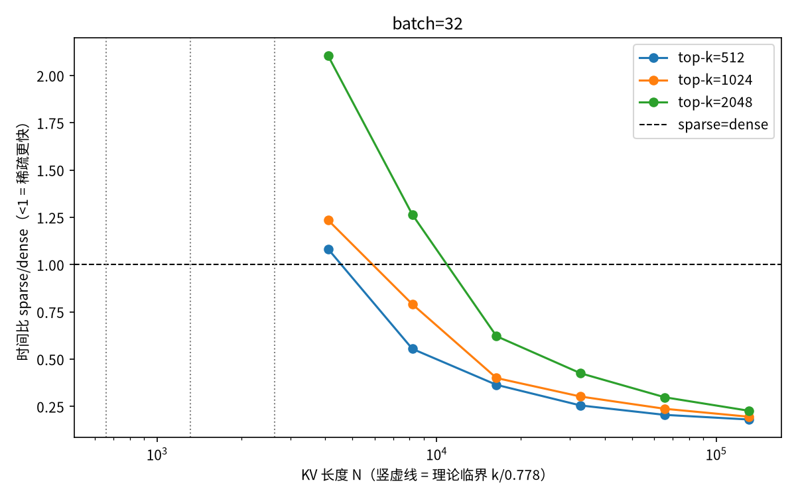

# 「多存一份索引，反而少读四分之三」，这笔账我算了一遍

前两天刷到一条抖音，讲 Kimi K3.1 Pro 的 KV Cache。标题说它多存了一份索引，长上下文下相关注意力层的读取量反而少了约四分之三，还从一个左括号讲起。评论区大概分两派，一派觉得反直觉，一派觉得是营销话术。

我被这句话勾住，是因为它指向两种不同的资源。一种是显存容量，prefill 那一下付掉的。另一种是显存带宽，每生成一个 token 都要再付一遍。拿前者的两成去换后者的七成多，只要不爆显存，这笔买卖怎么算都划算。反直觉的说法，拆开是两个账户。

麻烦在于，官方文档里找不到支撑这句话的参数。

Kimi 的两篇官方博客我都翻过。K3 那篇（2026-07-17）讲了 KDA 混合线性注意力、Gated MLA、2.8 万亿参数、100 万上下文，还说过一句实在话，KDA 给传统 prefix caching 带来了新的挑战，他们向 vLLM 社区贡献了对应实现。K3.1 Pro 那篇更干净，只讲能力和跑分，架构细节一个字没有，说是随技术报告公布。HuggingFace 上权重是有的，仓库 2026-11-02 建，衍生仓一堆，索引维度和 top-k 这类参数没人写过。

所以这条四分之三，机制上讲得通，参数在官方文字里查无实据。我把能查的部分查完，又把讲得通的部分自己测了一遍，最后去读了 config.json。

## KV Cache 做了一笔什么交易

先回到那个左括号。模型要接在 `print(` 后面，下一个 token 可能是字符串，可能是数字，可能是变量名。光看这个括号，它给不出答案，答案藏在括号前面的所有内容里。注意力干的就是回头这件事，新来的 token 生成一个 query，跟前面每个 token 的 key 对一遍，再按权重把它们的 value 混起来。

没有 cache 的时候，生成第 t 个 token，前面 t-1 个 token 的 key 和 value 都要重新算。整个序列写完，同样的投影被重算了平方次。cache 把这笔重复劳动砍掉，prefill 阶段算一次存下来，之后每步只算新 token 的。

代价是问题的性质换了。prefill 是并行的、算力密集的，GPU 吃得很饱。decode 是串行的，每步只做一个 token 的矩阵向量乘。拿 H100 算一笔账，decode 阶段 attention 每读一个字节的内存只做两次浮点运算，而这张卡的算力和带宽之比接近 295 比 1。计算单元九成九的时间在等数据。

结论很干脆。attention 的时间约等于读的字节数除以带宽，少读四倍就快四倍。后面所有数字都建立在这条上。

## 索引的账本

记每个 token 每层缓存 d 字节，上下文长度 N。dense 路径每步读 d 乘 N。稀疏路径分两段，先用一把便宜的小键给全部 N 个位置打分，再把选中的 k 个位置的大值取回来。每步读的字节是索引的 d_i 乘 N，加上主 KV 的 d 乘 k。

存储则涨了一份。拿公开可查的 DSA 口径算（fp8），原始 MLA 每 token 每层 576 字节，索引键 128 字节，合计 704，存储涨 22.2%。读取按 128K 上下文、top-k 取 2048 算。

| 每步每层 | 字节 | 占 dense |
|---|---|---|
| dense 全读 | 75.5 MB | 100% |
| 索引扫全部 | 16.8 MB | 22.2% |
| 取 top-k | 1.18 MB | 1.6% |
| 稀疏合计 | 18.0 MB | 23.8% |

少读 76.2%，四分之三就是从这类算术里出来的。它几乎不随上下文变长，因为省下的部分被索引扫描的固定占比锁死了。

这笔账有适用边界。令稀疏便宜过 dense，解出来 k 要小于 0.778 倍的 N。k 取 2048，上下文得超过两千六百多 token 才开始赚。上下文只有两千的时候，k 比 N 还大，稀疏读得更多。所以索引不是普适的加速，vLLM、SGLang、TensorRT-LLM 三家都默认在短上下文跳过 indexer，退回 dense，道理就在这。

## 我把它搬上 Kaggle 测了一遍

查完资料我不太甘心，想看看这些比值在真显卡上站不站得住。写了个微基准，把 dense 和「索引打分加 top-k 再 gather」两条路径用 PyTorch 摆出来，fp8 的字节数用 fp16 元素数模拟，逐字节还原上面的口径。它离生产 kernel 有距离，测的是流量物理，生产实现会在它之上再加选择开销，所以实测只会更保守。

先跑自检。k 等于 N 时，稀疏路径必须逐元素还原 dense 的输出，这一步抓路径写错。k 小于 N 时输出必须分开，这一步抓稀疏路径根本没生效。两条都过了才开始计时。

全网格在 Kaggle 的 T4 上跑，上下文 4K 到 128K 六档，top-k 三档，并发三档，一共 54 个配置。结果分两条说。

第一条，大上下文处比值贴住了字节模型。N 到 128K 时，九组配置的实测比值落在 0.181 到 0.227 之间，预测值是 0.226 到 0.238，偏差都在 15% 以内。并发越大贴得越紧，B 取 32 时最好。字节模型是成立的，四分之三在 128K 的口径下真实存在。

第二条，反超的位置比理论晚得多。k 取 2048，理论说上下文过 2633 就该赢，实测要拖到 16384，差六倍。k 取 512 更难看，理论 658，实测 8192，差十二倍。原因也不神秘，稀疏路径在我的实现里要起八次 kernel，每次 launch 都有几十微秒的固定开销，上下文不够长就摊不平。

## 边界是实现质量的函数

这是整趟实验里我觉得最值钱的发现。字节模型给出的交叉点是个下界，真实的反超位置取决于实现把多少次访存和计算揉进一个 kernel 里。朴素实现推右十二倍，融合得好的生产 kernel 会把它拉回来。

后来我把全网格搬到 AMD 的 W7900D 上重跑了一遍，ROCm 后端，50 次迭代口径。k 取 2048 的那几行比值 0.206 到 0.215，和 T4 的 0.216 到 0.227 互差不到一成，临界点表逐格相同，k 取 512 一样在 8192 反超，k 取 2048 一样在 16384 反超。但小 k 的行露了馅，AMD 系统性比 T4 快一到两成，它的 gather 在 ROCm 上做得更快。稀疏那条路的时间里，打分和取回各占多少，每家后端都不一样。所以比值也谈不上普适常数，它同时吃字节模型和取回内核的相对效率，边界是双重意义上的实现质量的函数。

vLLM 和 SGLang 那两个短上下文跳过 indexer 的默认值，正是这条边界的体现。引擎作者知道理论交叉点在哪，也知道自己的实现离它有多远，中间这段就是工程努力的方向。

并发是另一处。权重是所有请求共享的，每步读一次是常数。KV 不共享，随 batch 线性涨。拿 60 层、每层 576 字节算，权重读取按 50GB 记，128K 上下文要到并发 11 以上，KV 带宽才开始压过权重带宽。batch 等于 1 的时候，大头是权重，省 KV 省不出端到端收益。

所以那四分三是吞吐技术，给的是 Mooncake 那种高并发长会话的场景，不是单请求延迟技术。Kimi 自己说编程场景缓存率超过九成，实际输入价走到标准价的四分之一，靠的也是这套逻辑。

## 那这句话能不能信

拆成三档说。

官方可查的。K3 用 KDA 混合线性注意力加 Gated MLA，93 层里 69 层是线性注意力，只留一份恒定大小的状态，不产生逐 token 增长的 KV。技术报告 7 月底挂上了 arXiv（2607.24653），讲 KDA 与注意力残差的算法系统协同设计。社区记述的，索引式稀疏的整套账本（576、128、top-k、层间七成重合、跨层共享）来自 DeepSeek 的 DSA 和 CSA 系列、GLM 的 IndexCache，这些是公开的。我自己算和测的。四分之三的反推、交叉点公式、T4 上的 54 个实测点。机制成立，边界比理论靠右，batch 大时贴模型贴得很紧。

写到这里，账本里关于 K3.1 Pro 的那几个数还是借来的。所以我做了一件本来就该做的事：打开它的 config.json。

参数全在。93 层，从第 4 层起每四层留一个全注意力层，外加最后一层，一共 24 层跑 MLA 加索引式稀疏，剩下 69 层全是 KDA。全注意力层里每 token 每层存 kv_lora_rank 512 加 rope 64，正好 576 个元素；索引键 index_head_dim 128，正好是我账本里那个 128；index_topk 2048，正好是我算交叉点用的那个 k。我照 DeepSeek DSA 口径摆的那笔账，连数字带口径，和 Kimi 实际部署的参数一一对上。照这个混合比例算，整个模型逐 token 增长的缓存只有假想 93 层全 dense 版的三成。四分之三这句话，落在 K3.1 Pro 的 24 个全注意力层上，就是按我表格里那个比例读的。

所以最后的结论比开头预想的好。视频把 KDA 和索引两家摊在一起讲，讲法糙，但机制讲对了，量级也讲对了。剩下的悬念只剩实现层那点事，边界在哪个上下文长度真实反超、index_topk_freq 这类调度参数怎么用，交给 vLLM 里那份 Kimi 官方贡献的实现去兑现。config.json 不会说谎，这一回它把话说满了。
